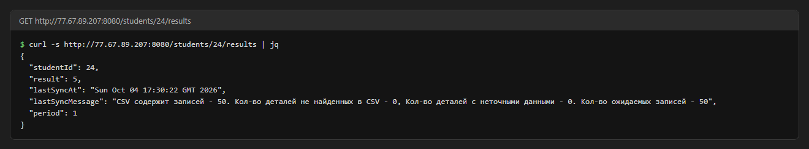
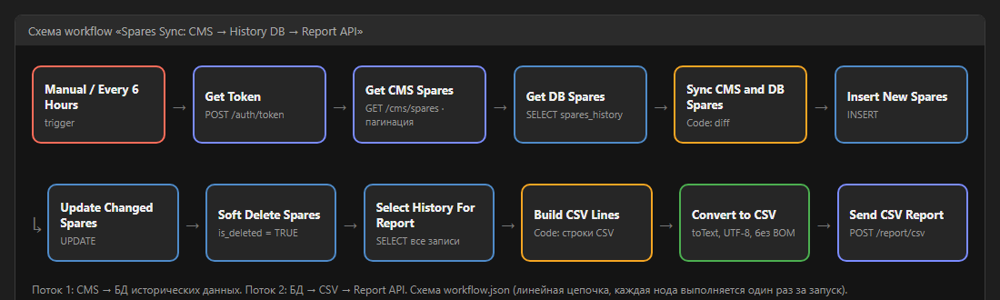
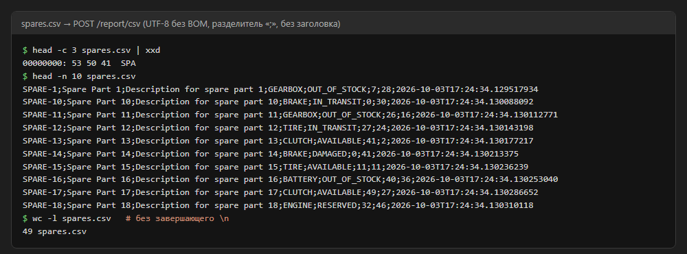
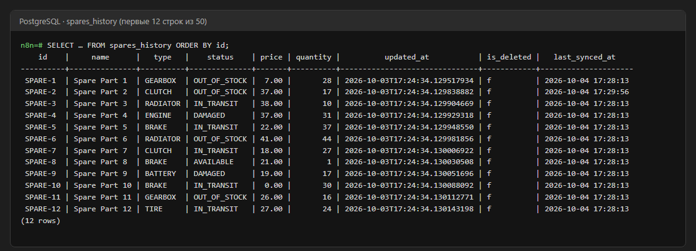

# Интеграционное приложение: CMS → БД исторических данных → Report API

Курсовая работа по дисциплине «Интеграция систем, разработка интеграционных сервисов».
Приложение синхронизирует детали со склада между тремя системами. Реализовано на **n8n** с **PostgreSQL**.

Спецификация API курса: <http://77.67.89.207:8080/swagger-ui/index.html>

| Система | Роль | Доступ |
|---|---|---|
| CMS | источник: текущий набор деталей на складе, без истории | `GET /cms/spares`, Basic Auth, пагинация (`page` с 0, `size` ≤ 10) |
| БД исторических данных | хранит все детали, включая пропавшие из CMS | PostgreSQL 16, таблица `spares_history` |
| Report API | принимает CSV с текущим состоянием БД | `POST /report/csv`, Bearer-токен из `POST /auth/token` |

## Результат самопроверки

`GET /students/24/results` после запуска workflow: оценка **5**, в CSV 50 записей из 50 ожидаемых, ненайденных и неточных нет.



## Схема workflow

```mermaid
flowchart LR
    T1[Manual Trigger] --> TOK
    T2[Every 6 Hours] --> TOK
    TOK[Get Token<br/>POST /auth/token] --> CMS[Get CMS Spares<br/>GET /cms/spares, все страницы]
    CMS --> DB[Get DB Spares<br/>SELECT spares_history]
    DB --> SYNC[Sync CMS and DB Spares<br/>сравнение]
    SYNC --> INS[Insert New Spares]
    INS --> UPD[Update Changed Spares]
    UPD --> DEL[Soft Delete Spares]
    DEL --> SEL[Select History For Report]
    SEL --> CSV[Build CSV Lines]
    CSV --> FILE[Convert to CSV<br/>UTF-8 без BOM]
    FILE --> SEND[Send CSV Report<br/>POST /report/csv]
```





### Поток данных № 1: CMS → БД

1. **Get Token** получает Bearer-токен для Report API. Логин и пароль берутся из переменных окружения `STUDENT_USERNAME` и `STUDENT_PASSWORD`, в репозитории их нет.
2. **Get CMS Spares** обходит все страницы `/cms/spares?page=N&size=10` встроенной пагинацией HTTP Request и останавливается на первой пустой странице.
3. **Get DB Spares** читает все записи из `spares_history`, в том числе помеченные удалёнными.
4. **Sync CMS and DB Spares** (Code) сравнивает наборы по `spareCode` и формирует три списка:
   - `to_insert` — деталей нет в БД;
   - `to_update` — изменилось хотя бы одно поле или деталь вернулась в CMS после удаления;
   - `to_delete` — деталь есть в БД, но пропала из CMS.
5. **Insert / Update / Soft Delete** применяют списки к БД. Данные передаются в запрос одним JSON-параметром (`$1::jsonb` + `jsonb_to_recordset`), поэтому кавычки в названиях не ломают SQL и нет SQL-инъекций. Пустой список — корректный запрос без изменений.

Удаление мягкое: запись остаётся в БД с `is_deleted = TRUE` и временем `deleted_at`. Так сохраняется история, которую CMS не хранит.

### Поток данных № 2: БД → Report API

1. **Select History For Report** выбирает все записи `spares_history`. CSV описывает текущее состояние БД исторических данных, поэтому детали, пропавшие из CMS во втором периоде, остаются в отчёте с последними известными значениями.
2. **Build CSV Lines** собирает строки в формате спецификации: без заголовка, разделитель `;`, перевод строки `\n`, порядок колонок `spareCode;spareName;spareDescription;spareType;spareStatus;price;quantity;updatedAt`. Поля с `;`, `"` или переводом строки экранируются по RFC 4180.
3. **Convert to CSV** (операция `toText`) превращает строку в файл UTF-8 **без BOM**.
4. **Send CSV Report** отправляет файл с заголовками `Content-Type: text/csv` и `Authorization: Bearer <token>`. В ответ Report API возвращает оценку.



## БД исторических данных

Схема лежит в [init.sql](init.sql) и создаётся автоматически при первом запуске контейнера PostgreSQL.

| Колонка | Тип | Источник |
|---|---|---|
| `id` | `VARCHAR(50)`, PK | `spareCode` |
| `name`, `description` | `TEXT` | `spareName`, `spareDescription` |
| `type`, `status` | `VARCHAR(50)` | `spareType`, `spareStatus` |
| `price` | `NUMERIC(12,2)` | `price` |
| `quantity` | `INTEGER` | `quantity` |
| `updated_at` | `TEXT` | `updatedAt` в исходном виде (CMS отдаёт наносекунды, `timestamptz` их обрезал бы) |
| `last_synced_at` | `TIMESTAMPTZ` | когда синхронизация последний раз меняла запись |
| `is_deleted`, `deleted_at` | `BOOLEAN`, `TIMESTAMPTZ` | мягкое удаление |



## Запуск

Нужны Docker и Docker Compose.

1. Создать `.env` по образцу [.env.example](.env.example) и указать свои данные студента:

   ```bash
   cp .env.example .env
   ```

2. Поднять PostgreSQL и n8n:

   ```bash
   docker compose up -d
   ```

3. Открыть <http://localhost:5678>, создать владельца n8n и импортировать [workflow.json](workflow.json) (меню «…» → Import from File).
4. Создать две учётные записи (credentials) и выбрать их в нодах:
   - **HTTP Basic Auth** для CMS (нода Get CMS Spares) — логин и пароль студента;
   - **Postgres** для нод работы с БД — хост `postgres`, порт `5432`, база, пользователь и пароль из `.env`.
5. Нажать **Execute workflow**. Чтобы синхронизация шла по расписанию раз в 6 часов, workflow нужно опубликовать (кнопка **Publish**).

Проверить оценку:

```bash
curl -s http://77.67.89.207:8080/students/24/results
```

## Что исправлено относительно первой версии

| Проблема | Последствие | Исправление |
|---|---|---|
| Get CMS Spares выполнялась для каждой строки из БД | CMS опрашивалась 50 раз, в выборке 2 500 дублей | цепочка перестроена, у нод чтения стоит `executeOnce` |
| Код синхронизации обращался к несуществующей ноде `Get_Current_DB` | данные БД всегда пустые: обновления и удаления не находились | сравнение идёт с выходом Get DB Spares |
| В Get DB Spares стояли заглушки `'GEARBOX'`, `'OUT_OF_STOCK'` | сравнение с реальными данными невозможно | читаются настоящие колонки |
| Insert с `ON CONFLICT DO NOTHING` на всех записях | старые неполные записи не обновлялись: 49 деталей с неточными данными | отдельные Insert, Update и Soft Delete по результатам сравнения |
| Switch без `allMatchingOutputs` | выполнялась только первая подходящая ветка; без изменений отчёт не отправлялся | Switch убран, цепочка линейная, отчёт уходит при каждом запуске |
| SQL собирался конкатенацией строк | апостроф в названии ломал запрос | параметр `$1::jsonb` |
| Цена округлялась до целого (`ROUND(price)`) | неточные данные при дробной цене | цена выводится без потери точности (`trim_scale`) |
| `updatedAt` хранился как `timestamptz` | терялись наносекунды и менялся формат | хранится исходная строка из CMS |
| Стандартный Convert to CSV добавляет UTF-8 BOM | Report API не находил первую деталь `SPARE-1` | CSV собирается в Code-ноде и сохраняется без BOM |
| Пароль студента был записан в workflow.json | утечка учётных данных в публичный репозиторий | вынесен в `.env` (не коммитится) |
| Не было схемы БД, `.gitignore` и запуска по расписанию | — | добавлены `init.sql`, `.gitignore`, `.env.example`, Schedule Trigger |

## Структура репозитория

```
├── docker-compose.yml   # PostgreSQL 16 + n8n
├── init.sql             # схема БД исторических данных
├── workflow.json        # экспорт workflow n8n
├── .env.example         # образец переменных окружения
└── docs/screenshots/    # скриншоты для README
```
